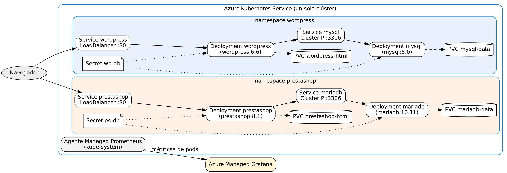

# Lab 6 — WordPress y PrestaShop en un solo AKS, con Grafana

Un clúster AKS hospeda dos portales en namespaces separados, cada uno con su propia base de datos:

| Namespace | Portal | Base de datos | Exposición |
|---|---|---|---|
| `wordpress` | `wordpress:6.6-apache` + PVC | `mysql:8.0` + PVC | Portal: LoadBalancer · BD: ClusterIP |
| `prestashop` | `prestashop/prestashop:8.1-apache` + PVC | `mariadb:10.11` + PVC | Portal: LoadBalancer · BD: ClusterIP |

Azure Managed Grafana observa el clúster a través de Managed Prometheus. No usa las bases de datos de los portales.



## Estructura
```
k8s/namespaces.yaml
k8s/wordpress/   secret.example.yaml  mysql.yaml  wordpress.yaml
k8s/prestashop/  secret.example.yaml  mariadb.yaml  prestashop-svc.yaml  prestashop.yaml
grafana/         dashboard-lab6.json  arquitectura.png
scripts/         00..07 por etapa, todo.sh, crear_producto.php
evidencias/      salidas de los scripts y capturas
```
Las credenciales **no** están en el repo: `scripts/02_secrets.sh` crea los Secrets `wp-db` y `ps-db` con contraseñas aleatorias. Los `secret.example.yaml` solo muestran la forma.

## Requisitos
Suscripción de Azure (Azure for Students), Azure CLI, azd y kubectl. En GitHub Codespaces, `scripts/00_herramientas.sh` los instala.

## Desplegar
```bash
chmod +x scripts/*.sh
./scripts/todo.sh                 # etapas 1 a 6 (30-40 min)
```
Por etapas:

| Script | Etapa |
|---|---|
| `01_infra.sh` | AKS + Grafana con `azd` y el template `sabbour/aks-app-template`. Plan B: `MODO=az ./scripts/01_infra.sh` (2 nodos Standard_B2s, tier free). Región: `LOC=eastus2` por defecto. |
| `02_secrets.sh` | Namespaces y Secrets |
| `03_desplegar.sh` | MySQL y MariaDB (espera Running y PVC Bound), luego WordPress y PrestaShop |
| `04_contenido.sh` | Instala WordPress (wp-cli), crea la página *Pagina de prueba Lab 6* y el producto *Producto de prueba Lab 6* |
| `05_reinicio.sh` | `kubectl rollout restart` de cada portal y su BD; verifica antes y después |
| `06_grafana.sh` | Importa el dashboard *Lab 6 — WordPress y PrestaShop en AKS* |
| `07_apagar.sh` | `azd down --purge` (o borra el grupo de recursos) |

Despliegue manual equivalente:
```bash
kubectl apply -f k8s/namespaces.yaml
kubectl -n wordpress  create secret generic wp-db --from-literal=root-password=... --from-literal=password=... --from-literal=admin-password=...
kubectl -n prestashop create secret generic ps-db --from-literal=root-password=... --from-literal=password=... --from-literal=admin-password=...
kubectl apply -f k8s/wordpress/mysql.yaml -f k8s/prestashop/mariadb.yaml
kubectl apply -f k8s/wordpress/wordpress.yaml -f k8s/prestashop/prestashop-svc.yaml
kubectl -n prestashop create configmap ps-config --from-literal=PS_DOMAIN=<IP del Service prestashop>
kubectl apply -f k8s/prestashop/prestashop.yaml
```

## Decisiones
- **`strategy: Recreate`** en los cuatro Deployments: los discos de Azure son ReadWriteOnce, así que el pod viejo debe soltar el disco antes de que arranque el nuevo.
- **`subPath`** en los volúmenes: el disco trae `lost+found` y MySQL/MariaDB no inicializan sobre un directorio no vacío.
- **initContainer `espera-bd`**: cada portal espera a que su propia BD responda en el 3306.
- **PrestaShop** se instala solo (`PS_INSTALL_AUTO=1`) con `PS_DOMAIN` = IP pública de su Service.

## Evidencias
Los scripts generan `evidencias/01..07_*.txt`. Capturas a agregar: `wordpress.png` (página de prueba), `prestashop.png` (producto de prueba), `grafana.png` (dashboard con los pods de los dos namespaces) y `costo.png` (Cost Management).
